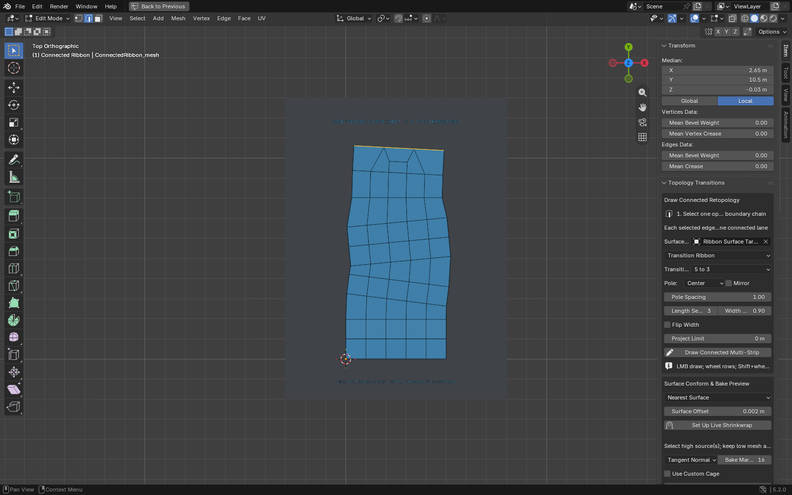

# Topology Transitions

Topology Transitions is a Blender add-on for building guided all-quad loop
reductions/expansions, repairing selected triangles and n-gons, reading broad
quad-flow regions, preparing shrinkwrapped retopology for selected-to-active
baking, and optionally drawing welded boundary-grown quad sheets.

Supported transition directions are 5 -> 3, 3 -> 5, 3 -> 1, 1 -> 3,
4 -> 2, 2 -> 4, 1 -> 2, and 2 -> 1. Pole placement, mirroring, surface
conformity, relaxation, and Catmull-Clark preview remain user-controlled.


## Install

1. Download `topology-transitions-<version>.zip` from GitHub Releases.
2. In Blender 4.2 or newer, open **Edit -> Preferences -> Get Extensions**.
3. Open the top-right menu, choose **Install from Disk**, and select the ZIP.
4. Open **3D View -> Sidebar -> Quad Transition**.

## Experimental connected drawing

This optional helper is hidden by default behind **Show Connected Drawing** in
the sidebar. It is a boundary-driven way to grow several welded quad lanes when
you specifically need a selected bottom edge chain to continue as one connected
sheet:

1. Keep the high-poly source as a separate visible mesh and choose it as
   **Surface Target**.
2. On the low-poly mesh in Edit Mode, select one open boundary edge chain. Each
   selected edge is one lane.
3. Choose **Connected Multi-Strip** for a uniform sheet or **Transition Ribbon**
   for one of the eight real density patterns.
4. Click **Draw Connected Sheet**, drag LMB over the target, adjust rows
   with the wheel and width with Shift+wheel, then press Enter.

The selected chain is reused as the exact first row, so the new faces weld to
the bottom quads instead of overlapping them. All lanes share their cross-row
vertices and commit as one connected all-quad mesh. The far boundary is selected
afterward for immediate continuation. Cyan filled preview cells show the entire
sheet; magenta cells mark transition poles.

The draw is transactional and target-specific. It cancels on a projection miss,
folded/zero-area quad, invalid pole, non-manifold edge, hidden/interior/branched
anchor chain, shape keys, or multi-object Edit Mode.



## Surface conformity and bake preview

**Set Up Live Shrinkwrap** creates or updates one named modifier against the
same target. Nearest Surface, Target Normal Project, and bidirectional Local Z
Project presets are exposed with offset and projection-limit controls.

For selected-to-active baking:

- **Toggle Bake Cage** shows an orange exact-topology inflated cage and detects
  when later edits make it stale.
- **Toggle Ray Preview** draws sampled high-source hits in green and misses in
  red, then reports coverage plus median and 95th-percentile hit distance.
- **Inspect Readiness** checks source selection, UVs, active bake images,
  transforms, winding, non-manifold geometry, and cage topology parity.
- **Configure Bake** prepares Cycles tangent-normal or displacement settings.
  It never starts a bake or overwrites an image.


The full workflow and implementation boundaries are documented in
[Experimental Connected Drawing, Surface Conformity, and Baking](docs/CONNECTED_MULTI_STRIP_AND_BAKING.md).

## Apply a transition

In Edit Mode, select either:

- one quad to insert a local connected transition stamp inside that face;
- a connected four-sided face patch; its interior may contain quads, triangles,
  or n-gons; or
- the closed outside edge loop of that patch.

Choose the transition and run **Validate**, then **Apply Transition**. The
outside boundary is pinned while the interior is replaced with the selected
all-quad template. A 5 -> 3 true patch replacement needs five incoming face
columns. A one-quad insertion preserves the selected quad's four outside edges
and places only the true transition core inside that space. This intentionally
leaves the surrounding area open for remesh/retopology work instead of adding a
local adapter frame. Generated faces receive a `topology_transition_role`
integer face layer: `2` means transition core.


The selected region still needs one disk-like boundary with four detectable
corners and compatible side parity. A loose, open edge chain is not enough to
define a replacement area.

## Solve selected tris and n-gons

The **Topology Repair** box keeps the two workflows separate:

- **Solve Selected Tris** first merges a compatible neighboring triangle. Only
  one triangle needs to be selected; its partner may be unselected.
- **Solve Selected N-gons** first uses a clean quad fan for even n-gons.
- Compatible triangle + odd-n-gon pairs are repaired as one even boundary.
- A completely isolated boundary face uses a center grid.
- For an embedded odd face, the solver carries edge splits through complete
  opposite-edge paths in the surrounding quad mesh, then rebuilds every touched
  face as quads.

That final method is intentionally topology-changing beyond the selected face:
an embedded odd-sided disk cannot become all-quad while every neighboring edge
remains unchanged. Propagating the cuts prevents the usual fake fix where the
triangle disappears but a pentagon appears one face away. The operation is
transactional, rejects hidden/non-manifold paths, and stops before touching more
than 10,000 faces.

Meshes with shape keys are rejected. New loops use default custom-data values,
so repaired regions with UVs, color attributes, custom normals, or creases may
need those data rebuilt.

## True density example atlas

In Object Mode, click **Add All Transition Examples**. Every labeled tile has:

1. three regular incoming rows with the stated input column count;
2. the actual pole-based transition; and
3. three regular outgoing rows with the different output column count.

The atlas is a joined, 186-face all-quad mesh with all eight transition
directions. It is meant to make density reduction/expansion visually obvious,
not to place a transition inside a same-count rectangular grid.

## Quad Flow Regions

The default **Quad Flow Regions** mode reads the retopology as broad patches:

1. interior extraordinary vertices are detected as poles;
2. separatrix edge paths continue topologically through regular valence-four
   vertices;
3. those paths, mesh boundaries, and non-quad boundaries become barriers; and
4. all visible quads are flood-filled into non-overlapping flow regions.


The overlay colors the complete region map, brightens and outlines the active
region, and shows its pole-separated boundaries. Mouse wheel/arrow keys move
from one complete region to the next and automatically center the camera on it.
**Enter** selects the region and exits; **S** selects and stays; **F** toggles
focus; **N** toggles the full map; **Esc/right-click** restores the original
selection.

For granular inspection, switch to **Individual Face Bands**. That legacy mode
shows one-quad-wide loops/strips continued through opposite quad edges. It is
useful, but it is no longer presented as the whole retopology flow map.


## Mesh Integrity

In Edit Mode, **Check & Select Manifold Issues** identifies and selects the exact
elements responsible for:

- open boundary edges (one linked face);
- over-connected non-manifold edges (more than two linked faces);
- wire edges (no linked faces); and
- isolated vertices.

Issue edges are grouped into connected areas. **Previous Issue** and **Next
Issue** select one component at a time and frame it in the 3D View. A closed
manifold mesh reports zero issues. An intentional open retopology sheet is still
reported accurately as an open boundary; the tool diagnoses rather than assumes
that every boundary is a mistake.

## Directional Face Delete

In Object Mode, select one or more mesh objects and use **Directional Face
Delete** to remove faces by world-axis direction:

- **+X** / **-X**
- **+Y** / **-Y**
- **+Z** / **-Z**

The operator deletes faces whose world-space normal points mostly toward the
chosen direction. If a selected object shares mesh data with another object, the
selected object is made single-user first so unselected duplicates are not
silently changed.

## Target Mesh Connector

The connector builds a triangular join between two mesh objects while letting
you inspect exactly what will be removed first:

1. On the mesh that will connect into the target, select one contiguous contact
   face region in Edit Mode, then return to Object Mode.
2. Select the target mesh as well, keeping the contact mesh active.
3. Adjust **Nearby Delete**. This is a world-space distance around the selected
   contact faces.
4. Click **Preview Red**. Target faces inside that distance appear as a
   translucent red overlay; **Red Preview Opacity** controls its visibility.
5. Click **Build Triangulated Connection**. A new combined object omits both
   contact regions and joins their boundary loops with triangles. The originals
   remain available but are hidden.

Both contact regions must produce one closed, non-branching boundary loop. Loop
vertex counts may differ: the connector advances around whichever side gives
the shorter next diagonal, producing a continuous triangle strip.

## Detached Face X-Ray

In Edit Mode, **Inspect / Refresh Red X-Ray** finds disconnected face islands
inside the active mesh without separating the object. The largest edge-connected
face region is treated as the main body. Every smaller region is shown through
the mesh in translucent red—even when it is extremely close to, overlaps, or
touches the main surface without sharing a real edge.

Use **Previous** and **Next** to select and frame one red region at a time. After
welding, bridging, or deleting the selected problem region, refresh the X-ray.
The counts and overlay disappear automatically when no detached face islands
remain. **Red X-Ray Opacity** controls both the all-error overlay and the brighter
current-region highlight.

## Directional Merge

In Edit Mode, select the close vertices that should weld and set **Merge
Distance**. Unlike Blender's ordinary merge-by-distance operation, Directional
Merge deliberately chooses the surviving position:

- **Center: Keep Outer** keeps the point farther from the object's world-space
  center.
- **Center: Keep Inner** keeps the point nearer the object's center.
- **Face Normals: Keep Outside** keeps the point farther along the average
  orientation of its surrounding faces.
- **Face Normals: Keep Inside** keeps the point farther against those normals.

The default **Selected Boundary / Loose** scope targets unwelded surface seams,
wire vertices, and isolated points. **All Selected** allows internal repair.
**Protect Existing Edges** avoids collapsing valid short edges by default; turn
it off when an intentional edge collapse is part of the repair. The same four
strategies are available from Blender's Edit Mode Merge menu.

## Main controls

| Control | Effect |
| --- | --- |
| Ribbon Layout | Draws a uniform connected sheet or a real loop-count transition. |
| Surface Target | Explicit high-poly mesh used for stroke hits and vertex projection. |
| Length Segments / Width Scale | Controls shared cross-rows and boundary-relative width. |
| Flip Width | Reverses which anchor endpoint is treated as the left side. |
| Transition | Incoming and outgoing loop counts. |
| Patch Axis | Uses the active boundary edge or the alternate patch axis. |
| Reverse Flow | Swaps incoming and outgoing patch sides. |
| Pole Side / Mirror | Places or mirrors the transition poles. |
| Pole Spacing | Adjusts initial extraordinary-vertex spacing. |
| Relax Strength / Iterations | Relaxes new interior vertices with a pinned boundary. |
| Conform to Surface | Projects new vertices to the original or explicit target mesh. |
| Flow View | Chooses whole regions or individual one-quad-wide bands. |
| Scope | Uses all visible faces or only selected faces. |
| Show Full Map | Colors all broad regions while one remains active. |
| Focus View | Frames the active region/band after each step. |
| Directional Face Delete | Removes selected-object faces by dominant world-axis normal. |
| Nearby Delete / Red Preview Opacity | Controls target-face reach and the translucent deletion overlay. |
| Build Triangulated Connection | Opens two face-defined loops and builds a connected triangular copy. |
| Detached Face X-Ray | Shows all smaller disconnected face islands through the active mesh in red. |
| Previous / Next Detached Region | Selects and frames one suspect face island for repair. |
| Directional Merge | Welds selected close vertices toward an explicit outer or inner survivor. |
| Shrinkwrap Method / Offset | Maintains non-destructive source conformity while editing. |
| Bake Cage / Ray Preview | Visualizes the envelope and sampled source reach before baking. |

## Safety and limitations

- Apply Transition accepts one selected quad, a compatible four-sided region, or
  that region's closed boundary loop. It does not decide artistic pole
  placement for an entire character.
- A one-quad insertion is intentionally a core-only placement. It removes the
  selected quad face and places the real transition pattern inset inside that
  area; it does not build the surrounding quad frame for you.
- Every accepted transition validates an all-quad connected disk, manifold edge
  counts, expected pole valence, nonzero face area, preserved boundary
  coordinates, preserved outside connectivity, and fitted-face fold checks.
- Repair propagation can add full edge paths across a large quad mesh. The
  operator reports how many splits and surrounding quads it changed.
- Directional Face Delete works from Object Mode and uses world-space dominant
  normals, so rotated objects are judged by how their faces point in the scene,
  not by their local mesh axes.
- Target Mesh Connector currently supports one closed boundary per contact
  region. It creates a new connected object and hides the two originals; it does
  not preserve UV or vertex-color data across the newly combined mesh.
- Detached Face X-Ray deliberately treats the largest face-connected region as
  the main body. Objects intentionally containing multiple disconnected shells
  will therefore show their smaller shells as suspects until they are joined or
  moved into separate objects.
- Face-normal directional merging assumes surrounding face normals are oriented
  consistently. Recalculate or flip incorrect normals before using those two
  strategies.
- Surface projection can choose the wrong sheet on tightly overlapping meshes;
  use an explicit projection target or disable conformity.
- The bake-ray overlay is a sampled diagnostic, not a replacement for the final
  Cycles bake. Green coverage does not prove UV or material correctness.
- New ribbon loops currently receive default UV/color/custom-data values and
  should be unwrapped before baking.
- Compound reductions such as 9 -> 5 are not automatically chained.
- Multi-object Edit Mode is rejected; edit one mesh data-block at a time.

## Development and verification

```powershell
python -m unittest discover -s tests -v
ruff check topology_transitions tests scripts
python -m compileall topology_transitions tests scripts
blender.exe --background --factory-startup --python tests\blender_smoke.py
python scripts\build_release.py
```

The Blender smoke is only accepted when it prints
`QT_BLENDER_SMOKE_PASS`. `tests/installed_smoke.py` verifies the installed ZIP
copy separately.

Key modules:

- `core.py`: pure transition templates and graph validation;
- `mesh_ops.py` / `operators.py`: selection analysis and transactional apply;
- `quad_repair.py` / `repair_ops.py`: local and propagated all-quad repair;
- `direction_delete_ops.py`: selected-object face removal by world-axis normal;
- `quad_flows.py` / `flow_ops.py`: pole-bounded regions, face bands, and overlay;
- `manifold.py` / `manifold_ops.py`: pure diagnostics and Blender selection;
- `ribbon.py` / `ribbon_ops.py`: connected multi-lane plans, surface fitting,
  modal preview, and transactional BMesh growth;
- `surface_ops.py`: live Shrinkwrap, exact-topology cages, and bake readiness;
- `bake_preview_ops.py`: sampled green-hit/red-miss bake-ray visualization;
- `examples.py`: true unequal-density atlas generation.

The topology derivation is in [docs/TOPOLOGY.md](docs/TOPOLOGY.md), and detailed
flow controls are in [docs/EDGE_FLOW_SCROLL.md](docs/EDGE_FLOW_SCROLL.md).

## License

MIT. See [LICENSE](LICENSE).
