# Topology Transitions: retopology and quad topology tools for Blender

[](https://github.com/CurioCrafter/Topology-Transitions/releases/latest)
[](#tested-blender-versions)
[](LICENSE)
[](https://github.com/CurioCrafter/Topology-Transitions/stargazers)
[](https://github.com/CurioCrafter/Topology-Transitions/discussions)

**A free Blender add-on that teaches topology while you build it.** Paint
quads straight onto a high-poly sculpt for retopology, see every pole light up
as you edit, and place real edge-loop transitions (5 -> 3, 3 -> 1, ...)
exactly where the mesh density needs to change. It also finds holes and
non-manifold geometry, turns triangles and n-gons into quads, and cleans up
dense remesher output.

Built for game assets, VR and real-time models, and anyone learning clean
quad topology and edge flow.

> **Got a question, a mesh it struggled with, or a retopo you are proud of?**
> Come say hi in [Discussions](https://github.com/CurioCrafter/Topology-Transitions/discussions): ask in
> [Q&A](https://github.com/CurioCrafter/Topology-Transitions/discussions/categories/q-a), suggest features in
> [Ideas](https://github.com/CurioCrafter/Topology-Transitions/discussions/categories/ideas), or post your results in
> [Show and tell](https://github.com/CurioCrafter/Topology-Transitions/discussions/categories/show-and-tell).
> If it saves you time, a star helps other Blender users find it.

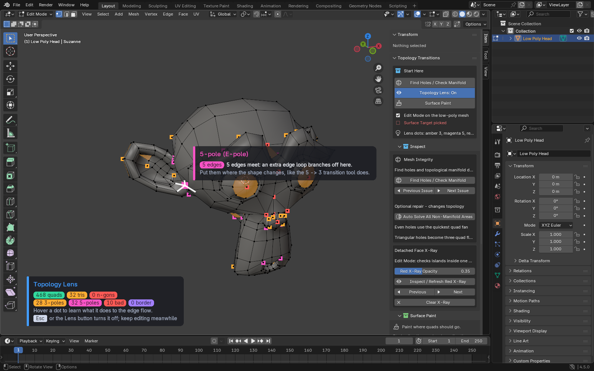

| | Tool | What it does for you |
| --- | --- | --- |
| 🔵 | **Find Holes / Check Manifold** | Finds open edges, hole rims, bad winding, wire edges and stray vertices, and steps you through each problem. |
| 🔵 | **Topology Lens** | A live overlay: amber dots are 3-poles, magenta 5-poles, red 6+ poles and doublets; triangles and n-gons are tinted. Hover any dot to learn what it does to edge flow. You keep editing while it is on. |
| 🟢 | **Surface Paint** | Paint where quads should go. A grid that walks over creases fills the paint, separate strokes join with transitions, and Mirror X paints both halves. |
| 🩷 | **Transitions** | Replace a quad patch with an all-quad 5 -> 3, 3 -> 5, 3 -> 1, 1 -> 3, 4 -> 2, 2 -> 4, 1 -> 2 or 2 -> 1 transition. |
| 🟠 | **Repair & Optimize** | Turn selected tris and n-gons into quads; remove repetitive remesher loops without creating triangles. |
| 🟣 | **Flow Browser** | Scroll through pole-bounded quad regions to read how a mesh flows. |
| 🟡 | **Merge & Cleanup** | Directional merge, delete faces by axis, and connect two meshes. |
| 🔴 | **Surface & Bake** | Live Shrinkwrap, exact bake cages, and a ray preview before you bake. |

Each colour matches a collapsible section of the sidebar, so the panel stays
short: open only the step you are on.

## What's new in 0.10

0.10 is the biggest update so far, focused on making retopology faster and
easier to learn:

- **Surface Paint Quads** replaces the old boundary strip drawing. Paint where
  quads should go; the grid walks over creases like a brow ridge instead of
  stopping there, borders come out smooth, separate strokes are joined with
  real 5 -> 3 style transitions, and **Mirror X** paints both halves at once.
- **Topology Lens**: a live, colour-coded overlay for 3-, 5- and 6+ poles,
  triangles and n-gons, with a hover card that explains each vertex. It stays
  on while you model.
- **A new sidebar**: a Start Here card with the three main tools and a setup
  checklist, followed by colour-coded sections that stay closed until needed,
  instead of one long panel.
- **Coach cards in the viewport**: every modal tool shows live counts and its
  keys as key caps, so there is nothing to memorise.

Full details are in the [changelog](CHANGELOG.md).

## Start Here: Find Holes and Check Manifold Issues

The sidebar opens with a **Start Here** card: three big buttons (Find Holes,
Topology Lens, Surface Paint) and a checklist that turns red until Edit Mode is
on and a Surface Target is picked.

In Edit Mode, run **Find Holes / Check Manifold**, the first button in the
sidebar. It selects:

- open boundary edges, including the rims of holes;
- over-connected edges shared by more than two faces;
- two-face edges whose adjacent faces have inconsistent winding;
- wire edges with no linked faces;
- isolated vertices; and
- vertices whose incident faces split into disconnected fans.

**Previous Issue** and **Next Issue** (in the **Inspect** section) isolate and
frame one connected problem area at a time. A clean result means none of those
tracked topological issue classes were found. Open boundaries can be
intentional, such as the outside of a retopology sheet, so the check reports
them without assuming every boundary needs repair. This is a topology check;
it does not test geometric self-intersections.

For supported automatic fixes, use **Auto Solve All Non-Manifold Areas** below
the diagnostic. That action changes topology; its safeguards and limits are
described under [Automatic Non-Manifold Repair](#automatic-non-manifold-repair).

## Install

1. Download `topology-transitions-<version>.zip` from
   [GitHub Releases](https://github.com/CurioCrafter/Topology-Transitions/releases/latest).
2. In Blender 4.2 or newer, open **Edit -> Preferences -> Get Extensions**.
3. Open the top-right menu, choose **Install from Disk**, and select the ZIP.
   (You can also drag the ZIP into the Blender window.)
4. Open **3D View -> Sidebar -> Quad Transition**.

One ZIP works on every Blender version from 4.2 to 5.2.

### Tested Blender versions

| Blender | Automated tests | Viewport overlays checked |
| --- | --- | --- |
| 4.2.19 LTS | Pass | Yes |
| 4.5 LTS | Pass | Yes |
| 5.0.1 | Pass | - |
| 5.1.2 | Pass | Yes |
| 5.2.3 LTS | Pass | Yes |

Blender 4.1 and older cannot install Blender extensions and are not
supported. Blender 3.6 LTS reached end of life in 2025.

### Tested on real meshes

Before release, every main tool was run on a mix of real production meshes:
AI-generated scans (Rodin, Tripo; 6,000 to 24,000 triangles with hundreds of
open holes), game character armour (mostly quads with open borders), and a
low-poly game model. No tool left a non-manifold edge behind, Surface Paint
produced 120 to 256 clean quads on each in under 0.35 s, and tools that do not
apply to a mesh (for example the quad optimizer on a triangle mesh) refuse
with a clear message instead of changing anything. You can run the same sweep
on your own files with `tests/real_mesh_stress.py`.

## The sidebar

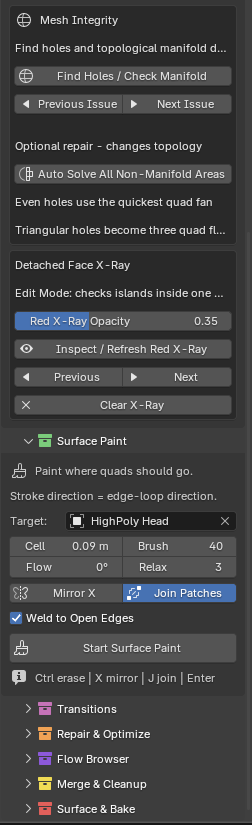

The panel is a **Start Here** card followed by coloured sections. **Inspect**
and **Surface Paint** start open; the rest stay closed until you need them.
Missing setup is shown in red (for example a Surface Target that has not been
picked yet), and the Start button stays disabled until it is fixed.

Toggles such as **Mirror X** and **Join Patches** light up when on, and every
modal tool lists its keys on screen as key caps, so nothing has to be
memorised.

<br clear="right">

## Topology Lens

Click **Topology Lens** in Start Here. It stays on while you model.

- **Amber** dots: 3-poles (N-poles). Loops turn a corner here.
- **Magenta** dots: 5-poles (E-poles). An extra loop branches off here.
- **Red** dots: 6+ poles and doublets, which pinch under subdivision.
- **Violet** dots: poles on an open border.
- **Amber / red tint**: triangles / n-gons.

The card in the corner counts quads, tris, n-gons and each pole type. Hover
any vertex for a card that names it, highlights its edges, and gives a tip on
what to do with it. Press Esc or click the button again to turn the lens off.

## Surface Paint Quads

Paint where you want topology on a high-poly mesh and get a clean quad grid
that follows the surface:

1. Choose the high-poly mesh as **Surface Target** and enter Edit Mode on your
   low-poly mesh (an empty mesh works).
2. Click **Surface Paint**, paint with LMB, erase with Ctrl+LMB.
3. Press Enter to build. Each stroke's direction becomes its edge-loop
   direction; R rotates it in 15-degree steps.

While you paint, the green preview is exactly what Enter will build, and the
coach card counts quads, poles and joins live:

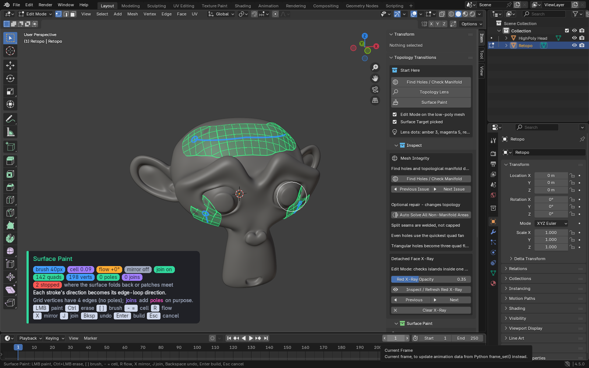

The forehead stroke walks over the brow ridge as one patch. The second stroke
on the cheek became its own patch, and **Join Patches** connected the two with
a transition: the magenta pole count shows the poles that join added on
purpose. After Enter the quads are added to the mesh and selected:

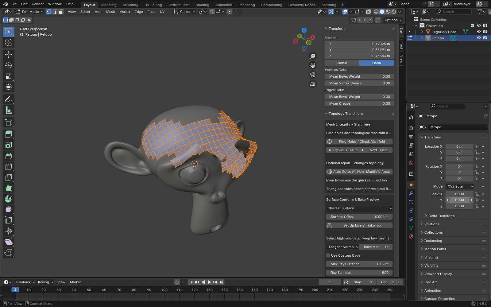

**Mirror X** (or the X key) paints both halves. One short stroke on one side
of the forehead gives a symmetric band with a shared centre seam:

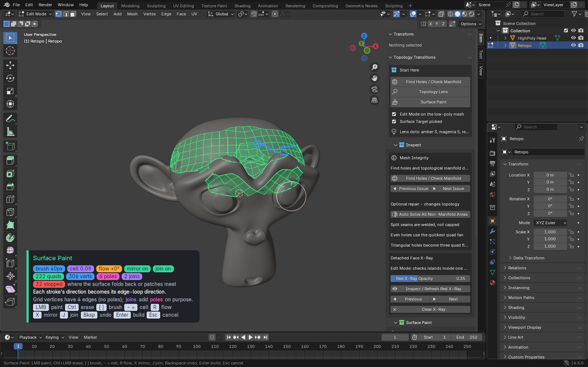

On a smooth sphere one stroke fills a clean cap:

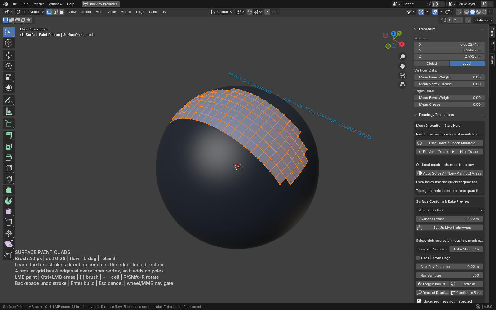

| Key | Action |
| --- | --- |
| LMB / Ctrl+LMB | Paint / erase |
| `[` `]` | Brush size |
| `-` `=` | Cell (quad) size |
| R / Shift+R | Rotate edge flow 15 degrees |
| X | Mirror X on/off |
| J | Join Patches on/off |
| Backspace | Undo the last stroke |
| Enter / Esc | Build / cancel |

Border vertices can weld onto open edges of the existing mesh. Deep sockets
and very sharp folds still leave ragged edges or gaps: paint those areas as
separate strokes, or use a smaller cell. How the grid is built is described in
[docs/SURFACE_PAINT_AND_BAKING.md](docs/SURFACE_PAINT_AND_BAKING.md).

## Surface conformity and bake preview

**Set Up Live Shrinkwrap** creates or updates one named modifier against the
same target. Nearest Surface, Target Normal Project, and bidirectional Local Z
Project presets are exposed with offset and projection-limit controls.

For selected-to-active baking:

- **Toggle Bake Cage** shows an orange exact-topology inflated cage and detects
  when later edits make it stale.
- **Toggle Ray Preview** draws sampled high-source hits in green and misses in
  red, then reports coverage plus median and 95th-percentile hit distance.
- **Inspect Readiness** checks source selection, UVs, active bake images,
  transforms, winding, non-manifold geometry, and cage topology parity.
- **Configure Bake** prepares Cycles tangent-normal or displacement settings.
  It never starts a bake or overwrites an image.

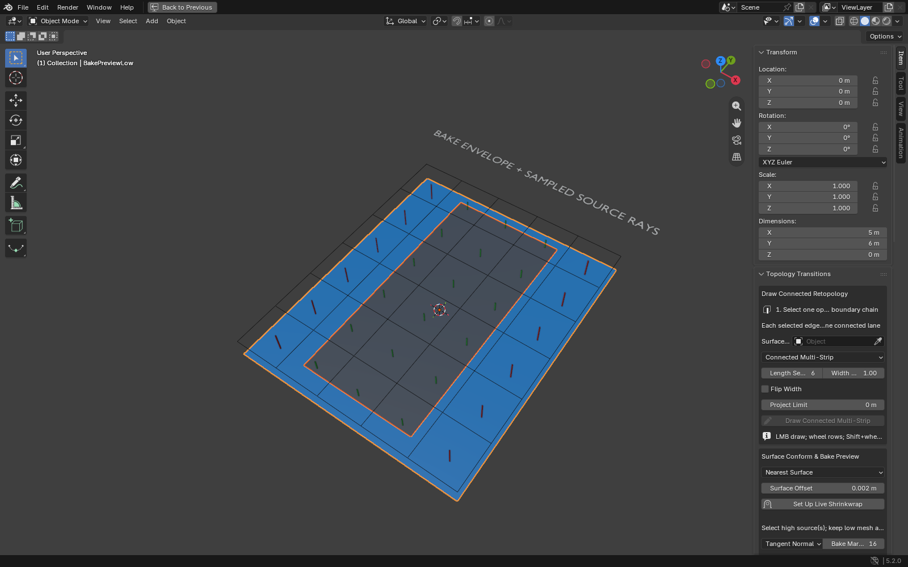

The full workflow and implementation boundaries are documented in
[Surface Paint, Surface Conformity, and Baking](docs/SURFACE_PAINT_AND_BAKING.md).

## Apply a transition

In Edit Mode, select either:

- one quad to insert a local connected transition stamp inside that face;
- a connected four-sided face patch; its interior may contain quads, triangles,
  or n-gons; or
- the closed outside edge loop of that patch.

Choose the transition and run **Validate**, then **Apply Transition**. The
outside boundary is pinned while the interior is replaced with the selected
all-quad template. A 5 -> 3 true patch replacement needs five incoming face
columns. A one-quad insertion preserves the selected quad's four outside edges
and places only the true transition core inside that space. This intentionally
leaves the surrounding area open for remesh/retopology work instead of adding a
local adapter frame. Generated faces receive a `topology_transition_role`
integer face layer: `2` means transition core.

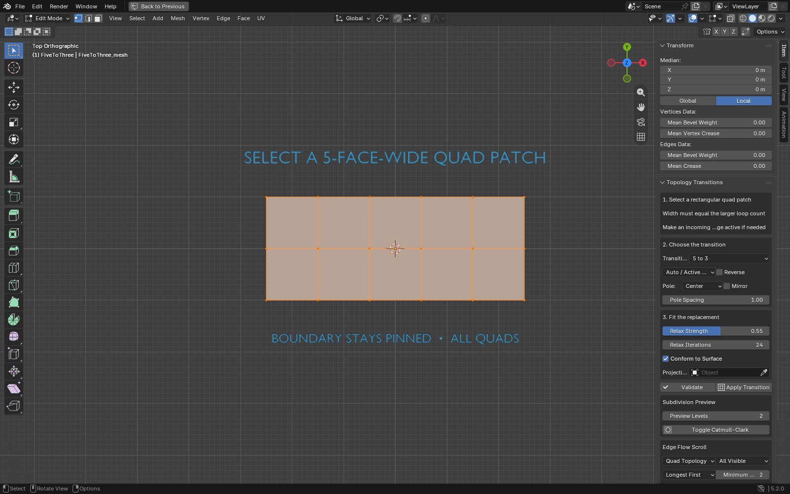

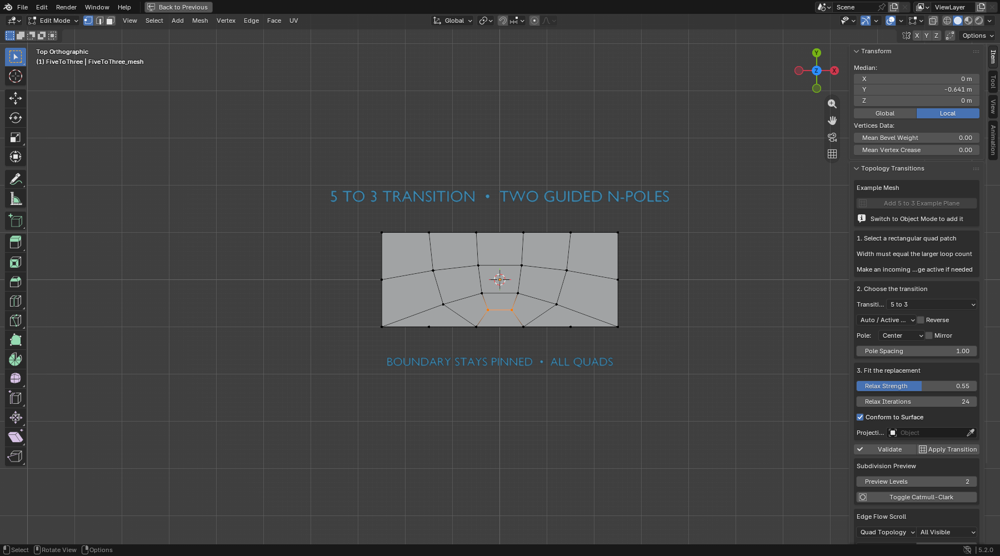

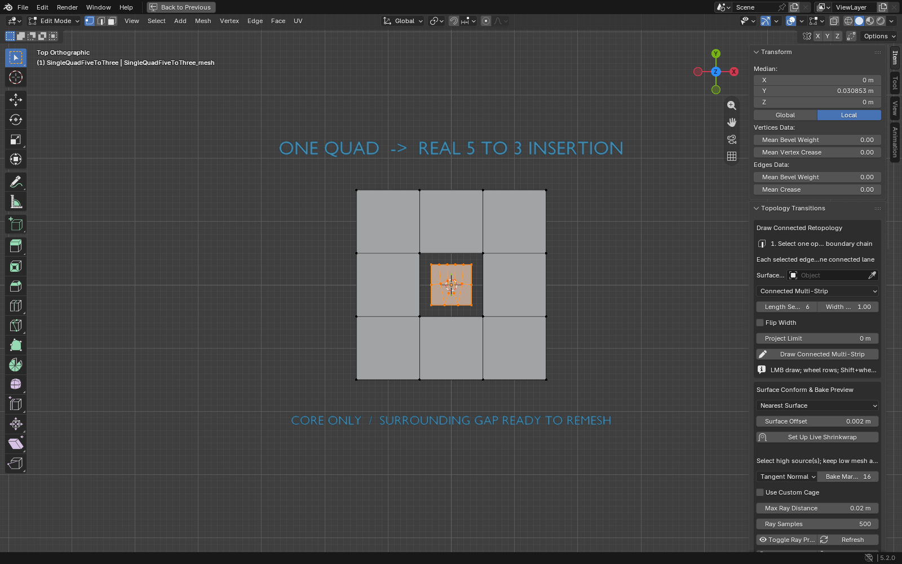

The selected region still needs one disk-like boundary with four detectable
corners and compatible side parity. A loose, open edge chain is not enough to
define a replacement area.

## Solve selected tris and n-gons

The **Topology Repair** box keeps the two workflows separate:

- **Solve Selected Tris** first merges a compatible neighboring triangle. Only
  one triangle needs to be selected; its partner may be unselected.
- **Solve Selected N-gons** first uses a clean quad fan for even n-gons.
- Compatible triangle + odd-n-gon pairs are repaired as one even boundary.
- A completely isolated boundary face uses a center grid.
- For an embedded odd face, the solver carries edge splits through complete
  opposite-edge paths in the surrounding quad mesh, then rebuilds every touched
  face as quads.

That final method is intentionally topology-changing beyond the selected face:
an embedded odd-sided disk cannot become all-quad while every neighboring edge
remains unchanged. Propagating the cuts prevents the usual fake fix where the
triangle disappears but a pentagon appears one face away. The operation is
transactional, rejects hidden/non-manifold paths, and stops before touching more
than 10,000 faces.

Meshes with shape keys are rejected. New loops use default custom-data values,
so repaired regions with UVs, color attributes, custom normals, or creases may
need those data rebuilt.

## Quad Flow Optimization

**Quad Flow Optimization** removes complete repetitive edge flows instead of
running a triangle-producing decimator. A candidate flow must continue through
ordinary quad topology, remain below the surface-angle and local error limits,
and avoid deleting a protected feature flow. Parallel neighboring loops
conflict, so the planner chooses an alternating set; perpendicular sets may run
together. On a regular patch this allows each 2x2 group to become one quad.

**Detection Mode** defaults to **Automatic**. Automatic tries the same mesh at
three sensitivity levels and stops at the first level that produces a valid
batch:

- **Conservative**: 8 degree surface angle, 2.5% error, four-edge minimum,
  one branch guard ring, and locked open boundaries;
- **Balanced**: 18 degree surface angle, 5% error, three-edge minimum, no extra
  guard ring, and straight boundary-to-boundary flows allowed; and
- **Aggressive**: 35 degree surface angle, 10% error, two-edge minimum, no extra
  guard ring, and straight boundary-to-boundary flows allowed.

Explicit UV seams, marked-sharp edges, weighted creases, and material borders
remain protected at every sensitivity level when their preservation switches
are enabled. **Custom** exposes every numeric threshold and the open-boundary
switch directly.

### What every optimization term means

- **Detection Mode** controls how readily a complete edge flow qualifies.
  Automatic escalates only when a stricter level finds nothing.
- **Scope** is either every visible quad on the active mesh or only complete
  flows whose adjacent faces are selected.
- **Optimization Cycles** re-analyzes the simplified result. One cycle roughly
  halves eligible density; additional cycles can reduce it again.
- **Max Surface Angle** is the largest face-to-face bend across an edge flow
  that may be removed. A smaller value keeps more curved detail.
- **Crease Angle** is the bend at which an ordinary geometric edge is classified
  as a protected crease. A smaller value protects more edges.
- **Max Surface Error %** is the allowed old-to-new surface distance, measured
  relative to the median local edge length. A smaller value retains shape more
  strictly.
- **Branch Guard Rings** keeps that many surrounding quad rings dense around
  poles, corners, and feature junctions.
- **Minimum Flow Length** ignores complete flows shorter than this edge count.
- **Preserve Open Boundaries** prevents density changes along the outside edge
  of an open sheet. Balanced and Aggressive presets allow straight
  boundary-to-boundary flows; Custom exposes this as a switch.
- **Preserve UV Seams** retains texture-island borders.
- **Preserve Sharp Edges** retains Blender edges marked Sharp for shading.
- **Preserve Creases** retains weighted subdivision creases and edges above the
  Crease Angle.
- **Preserve Materials** retains borders between different face materials.
- **Analyze / Select Flows** previews the alternating batch that the next cycle
  would remove. It does not alter topology.
- **Candidates** are complete flows that passed the current filters; **Mode
  Used** shows the sensitivity level Automatic selected.

If no flow qualifies, the panel now reports the main reasons instead of only
showing "No eligible repetitive quad flows". Typical reasons are protected
open boundaries, short flows, excessive surface error, high curvature, selected
scope, or flows interrupted by poles and irregular branches.

If a complete batch would change the Euler characteristic, boundary-component
count, non-manifold state, wire edges, or isolated vertices, the optimizer does
not disable that safety check. It automatically splits the batch into smaller
groups, validates them on mesh copies, commits the largest proven-safe subset,
and reports how many conflicting flows were deferred. Run another cycle to
re-analyze those remaining areas after the safe reduction.

Straight edge flows crossing a crease can still be simplified: the crease line
is continued through the new longer edge and its seam/sharp/crease properties
are restored. The crease itself is never selected as a removable flow. UVs on
the tested linear grid remain unchanged; complicated UV interiors should still
be inspected after any topology reduction.

**Analyze / Select Flows** selects the next compatible batch for All Visible
scope. With Selected Faces scope it reports the eligible batch without replacing
the face selection, so **Optimize Quad Flow** can use that same selected region.

Each topology pass runs on a copy and is accepted only if it reduces faces,
leaves every face a non-degenerate quad, preserves the Euler and manifold/
boundary signatures, and stays inside a bounded BVH distance sample. Curved or
irregular regions can therefore remain dense while a disconnected flat region
is simplified. Shape-key meshes are rejected, and linked mesh data is made
single-user only in Object Mode.

Open sheets keep their boundary density by default. Turn off **Preserve Open
Boundaries** only when straight boundary-to-boundary flows may be simplified.
The optimizer does not invent transition patches for partial loops: if a flow
ends at a branch or would create a non-quad, it is left unchanged.

## True density example atlas

In Object Mode, click **Add All Transition Examples**. Every labeled tile has:

1. three regular incoming rows with the stated input column count;
2. the actual pole-based transition; and
3. three regular outgoing rows with the different output column count.

The atlas is a joined, 186-face all-quad mesh with all eight transition
directions. It is meant to make density reduction/expansion visually obvious,
not to place a transition inside a same-count rectangular grid.

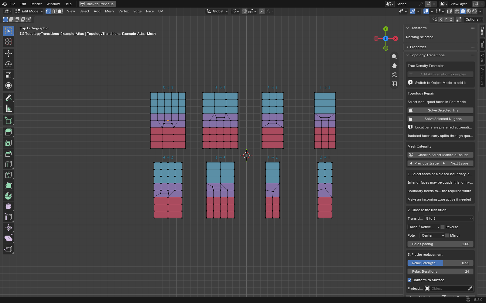

## Quad Flow Regions

The default **Quad Flow Regions** mode reads the retopology as broad patches:

1. interior extraordinary vertices are detected as poles;
2. separatrix edge paths continue topologically through regular valence-four
   vertices;
3. those paths, mesh boundaries, and non-quad boundaries become barriers; and
4. all visible quads are flood-filled into non-overlapping flow regions.

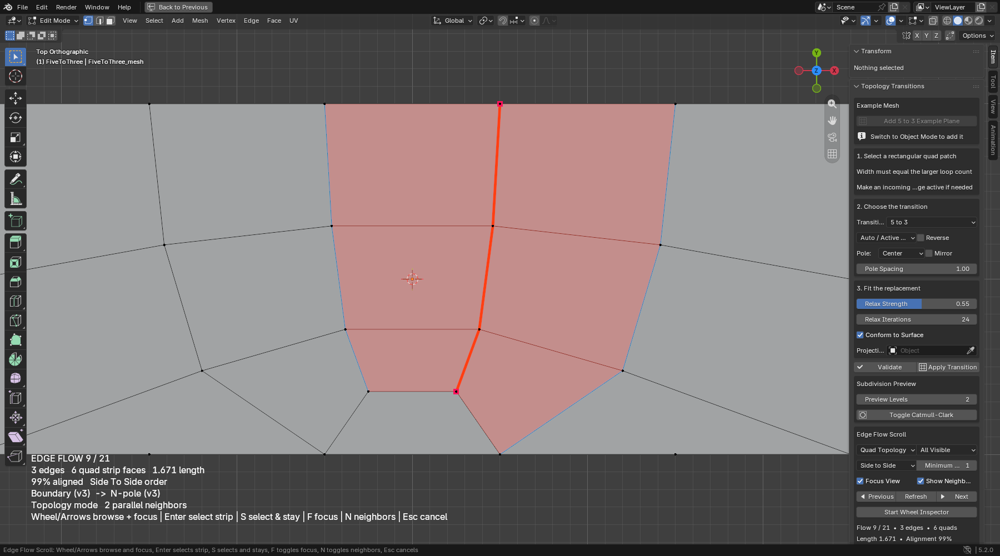

The overlay colors the complete region map, brightens and outlines the active
region, and shows its pole-separated boundaries. Mouse wheel/arrow keys move
from one complete region to the next and automatically center the camera on it.
**Enter** selects the region and exits; **S** selects and stays; **F** toggles
focus; **N** toggles the full map; **Esc/right-click** restores the original
selection.

For granular inspection, switch to **Individual Face Bands**. That legacy mode
shows one-quad-wide loops/strips continued through opposite quad edges. It is
useful, but it is no longer presented as the whole retopology flow map.

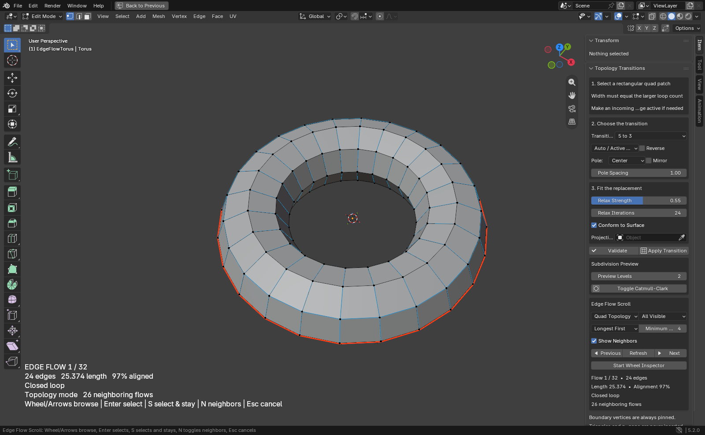

## Automatic Non-Manifold Repair

With one active mesh in Object or Edit Mode, **Auto Solve All Non-Manifold
Areas** runs the complete safe repair portfolio:

1. exact duplicate faces are removed when they are the cause of an
   over-connected edge;
2. wire edges and isolated vertices are removed;
3. every simple closed open-edge loop is filled;
4. clean even loops use the lowest-face-count valid quad fan; and
5. odd loops use a center grid whose required midpoint cuts continue through
   opposite edges of neighboring quad flows.

A triangular hole therefore becomes three quads around one center. Those three
new edge flows continue through adjacent faces when parity requires it, so the
repair remains conforming and does not leave T-junctions or push a pentagon into
the next face. Each boundary is tried on a mesh copy, and one boundary cannot
partially damage the working mesh if its validation fails.

There is no geometry-only rule that can choose which arbitrary sheet to delete
when three genuinely different surfaces share one edge. Branched boundaries,
non-duplicate over-connected sheets, and one-face open sheets are therefore
left unchanged and selected, with the unresolved count shown in the panel.
That is an explicit safety boundary rather than a claim that every malformed or
self-intersecting input has one correct automatic repair.

Inconsistent face winding and disconnected face-fan vertices are diagnostic
results, not automatic-repair targets. They remain selected for an explicit
normal-orientation or topology decision instead of being changed by guesswork.

The solver rejects shape-key meshes and limits one propagated repair to 10,000
faces. In Object Mode it makes the active object single-user before committing
when its mesh data is linked; linked data in Edit Mode is rejected with guidance
to switch modes. New loops inherit material and smooth settings, but start with
default UV and color-attribute values, so those data need inspection after a
topology change.

For the non-topology-changing diagnostic and issue navigation workflow, see
[Start Here: Find Holes and Check Manifold Issues](#start-here-find-holes-and-check-manifold-issues).

## Directional Face Delete

In Object Mode, select one or more mesh objects and use **Directional Face
Delete** to remove faces by world-axis direction:

- **+X** / **-X**
- **+Y** / **-Y**
- **+Z** / **-Z**

The operator deletes faces whose world-space normal points mostly toward the
chosen direction. If a selected object shares mesh data with another object, the
selected object is made single-user first so unselected duplicates are not
silently changed.

## Target Mesh Connector

The connector builds a triangular join between two mesh objects while letting
you inspect exactly what will be removed first:

1. On the mesh that will connect into the target, select one contiguous contact
   face region in Edit Mode, then return to Object Mode.
2. Select the target mesh as well, keeping the contact mesh active.
3. Adjust **Nearby Delete**. This is a world-space distance around the selected
   contact faces.
4. Click **Preview Red**. Target faces inside that distance appear as a
   translucent red overlay; **Red Preview Opacity** controls its visibility.
5. Click **Build Triangulated Connection**. A new combined object omits both
   contact regions and joins their boundary loops with triangles. The originals
   remain available but are hidden.

Both contact regions must produce one closed, non-branching boundary loop. Loop
vertex counts may differ: the connector advances around whichever side gives
the shorter next diagonal, producing a continuous triangle strip.

## Detached Face X-Ray

In Edit Mode, **Inspect / Refresh Red X-Ray** finds disconnected face islands
inside the active mesh without separating the object. The largest edge-connected
face region is treated as the main body. Every smaller region is shown through
the mesh in translucent red—even when it is extremely close to, overlaps, or
touches the main surface without sharing a real edge.

Use **Previous** and **Next** to select and frame one red region at a time. After
welding, bridging, or deleting the selected problem region, refresh the X-ray.
The counts and overlay disappear automatically when no detached face islands
remain. **Red X-Ray Opacity** controls both the all-error overlay and the brighter
current-region highlight.

## Directional Merge

In Edit Mode, select the close vertices that should weld and set **Merge
Distance**. Unlike Blender's ordinary merge-by-distance operation, Directional
Merge deliberately chooses the surviving position:

- **Center: Keep Outer** keeps the point farther from the object's world-space
  center.
- **Center: Keep Inner** keeps the point nearer the object's center.
- **Face Normals: Keep Outside** keeps the point farther along the average
  orientation of its surrounding faces.
- **Face Normals: Keep Inside** keeps the point farther against those normals.
- **View: Keep Toward You** keeps the point closest to your current viewpoint.
- **View: Keep Away From You** keeps the deeper point along the direction you
  are currently looking.

The optional **Selected Boundary / Loose** scope targets unwelded surface seams,
wire vertices, and isolated points. The default is **All Selected** so an
explicit vertex selection works immediately. **Protect Existing Edges** is
available for seam-only repair but is off by default. **Always Merge Exact Pair**
lets exactly two selected vertices override Merge Distance. **Protect UVs** is
on by default and preserves every surviving attached face corner across all UV
maps, including seams, pins, and any UV selection state exposed by the running
Blender version. When an existing edge is collapsed and one of its two UV
corners must disappear, that face keeps the UV
of the vertex selected by the current Keep Inner/Outer/View strategy; UVs on
the other attached faces remain face-local and unchanged. The same six
strategies are available from Blender's Edit Mode Merge menu.
The two view strategies read the active 3D viewport, so they follow perspective,
orthographic, and camera-aligned views instead of using a fixed world axis.

## Main controls

| Control | Effect |
| --- | --- |
| Surface Target | Explicit high-poly mesh used for painting and vertex projection. |
| Cell Size / Brush | Quad edge length (zero = from first dab) and brush radius in pixels. |
| Flow / Relax | Edge-loop rotation and on-surface smoothing passes for Surface Paint. |
| Mirror X / Join Patches | Paint one half and mirror it; join separate strokes with transitions. |
| Topology Lens | Live colour-coded poles, tris and n-gons with hover explanations. |
| Transition | Incoming and outgoing loop counts. |
| Patch Axis | Uses the active boundary edge or the alternate patch axis. |
| Reverse Flow | Swaps incoming and outgoing patch sides. |
| Pole Side / Mirror | Places or mirrors the transition poles. |
| Pole Spacing | Adjusts initial extraordinary-vertex spacing. |
| Relax Strength / Iterations | Relaxes new interior vertices with a pinned boundary. |
| Conform to Surface | Projects new vertices to the original or explicit target mesh. |
| Flow View | Chooses whole regions or individual one-quad-wide bands. |
| Scope | Uses all visible faces or only selected faces. |
| Show Full Map | Colors all broad regions while one remains active. |
| Focus View | Frames the active region/band after each step. |
| Directional Face Delete | Removes selected-object faces by dominant world-axis normal. |
| Nearby Delete / Red Preview Opacity | Controls target-face reach and the translucent deletion overlay. |
| Build Triangulated Connection | Opens two face-defined loops and builds a connected triangular copy. |
| Detached Face X-Ray | Shows all smaller disconnected face islands through the active mesh in red. |
| Previous / Next Detached Region | Selects and frames one suspect face island for repair. |
| Directional Merge | Welds selected close vertices toward an explicit outer or inner survivor. |
| Shrinkwrap Method / Offset | Maintains non-destructive source conformity while editing. |
| Bake Cage / Ray Preview | Visualizes the envelope and sampled source reach before baking. |

## Safety and limitations

- Apply Transition accepts one selected quad, a compatible four-sided region, or
  that region's closed boundary loop. It does not decide artistic pole
  placement for an entire character.
- A one-quad insertion is intentionally a core-only placement. It removes the
  selected quad face and places the real transition pattern inset inside that
  area; it does not build the surrounding quad frame for you.
- Every accepted transition validates an all-quad connected disk, manifold edge
  counts, expected pole valence, nonzero face area, preserved boundary
  coordinates, preserved outside connectivity, and fitted-face fold checks.
- Repair propagation can add full edge paths across a large quad mesh. The
  operator reports how many splits and surrounding quads it changed.
- Directional Face Delete works from Object Mode and uses world-space dominant
  normals, so rotated objects are judged by how their faces point in the scene,
  not by their local mesh axes.
- Target Mesh Connector currently supports one closed boundary per contact
  region. It creates a new connected object and hides the two originals; it does
  not preserve UV or vertex-color data across the newly combined mesh.
- Detached Face X-Ray deliberately treats the largest face-connected region as
  the main body. Objects intentionally containing multiple disconnected shells
  will therefore show their smaller shells as suspects until they are joined or
  moved into separate objects.
- Face-normal directional merging assumes surrounding face normals are oriented
  consistently. Recalculate or flip incorrect normals before using those two
  strategies.
- Surface projection can choose the wrong sheet on tightly overlapping meshes;
  use an explicit projection target or disable conformity.
- The bake-ray overlay is a sampled diagnostic, not a replacement for the final
  Cycles bake. Green coverage does not prove UV or material correctness.
- New Surface Paint quads currently receive default UV/color/custom-data values and
  should be unwrapped before baking.
- Compound reductions such as 9 -> 5 are not automatically chained.
- Multi-object Edit Mode is rejected; edit one mesh data-block at a time.

## Development and verification

```powershell
python -m unittest discover -s tests -v
ruff check topology_transitions tests scripts
python -m compileall topology_transitions tests scripts
blender.exe --background --factory-startup --python tests\blender_smoke.py
python scripts\build_release.py
```

`tests/real_mesh_stress.py` runs every main tool on one of your own mesh files
(GLB, glTF, FBX, OBJ or DAE) and prints a JSON line with status, timing and a
manifold check per tool:

```powershell
blender.exe -b --factory-startup --python tests\real_mesh_stress.py -- path\to\mesh.glb
```

README screenshots are reproducible with `scripts/capture_showcase.py` (see
its docstring) and `scripts/capture_docs.py`.

The Blender smoke is only accepted when it prints
`QT_BLENDER_SMOKE_PASS`. `tests/installed_smoke.py` verifies the installed ZIP
copy separately.

Key modules:

- `core.py`: pure transition templates and graph validation;
- `mesh_ops.py` / `operators.py`: selection analysis and transactional apply;
- `quad_repair.py` / `repair_ops.py`: local and propagated all-quad repair;
- `quad_optimize.py` / `optimize_ops.py`: feature-aware repetitive flow removal;
- `direction_delete_ops.py`: selected-object face removal by world-axis normal;
- `quad_flows.py` / `flow_ops.py`: pole-bounded regions, face bands, and overlay;
- `manifold.py` / `manifold_ops.py`: pure diagnostics and Blender selection;
- `paint_grid.py` / `surface_paint_ops.py`: brush coverage, spine-and-rib
  surface walking, border cleanup, transition joins, mirroring, relaxation, and
  transactional welding;
- `lens_ops.py`: the live Topology Lens overlay and hover explanations;
- `hud.py`: the coloured in-viewport coach cards, chips and key caps;
- `ui.py`: the Start Here card and the coloured sidebar sections;
- `surface_ops.py`: live Shrinkwrap, exact-topology cages, and bake readiness;
- `bake_preview_ops.py`: sampled green-hit/red-miss bake-ray visualization;
- `examples.py`: true unequal-density atlas generation.

The topology derivation is in [docs/TOPOLOGY.md](docs/TOPOLOGY.md), and detailed
flow controls are in [docs/EDGE_FLOW_SCROLL.md](docs/EDGE_FLOW_SCROLL.md).

## Community and contributing

- **Questions and help:** [Q&A discussions](https://github.com/CurioCrafter/Topology-Transitions/discussions/categories/q-a).
- **Feature ideas:** [Ideas](https://github.com/CurioCrafter/Topology-Transitions/discussions/categories/ideas). Tell us
  which topology problem you keep fixing by hand.
- **Show your work:** [Show and tell](https://github.com/CurioCrafter/Topology-Transitions/discussions/categories/show-and-tell).
  Before/after retopology shots help everyone learn.
- **Bugs:** [open an issue](https://github.com/CurioCrafter/Topology-Transitions/issues) with your Blender version, what you
  selected, and the message the add-on showed. A small .blend helps a lot.
- **Code:** pull requests are welcome. Run the checks in
  [Development and verification](#development-and-verification) first.

If Topology Transitions helps you, please star the repository so more Blender
artists can find it.

## License

MIT. See [LICENSE](LICENSE).
